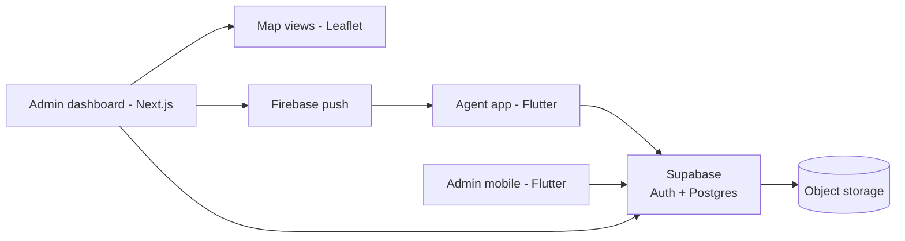

# MetLife Hafiz Agency: Field-Agent CRM

> **Architecture case study.** Source code is private and owned by the client. This repository contains original documentation only: no client code, data, credentials or assets.

## Architecture

## Problem

An insurance agency manages a team of field agents. Managers needed visibility of agents' activity, leads and location, and agents needed a simple mobile tool to record their work.

## Solution

A CRM made of three apps on one backend: a web admin dashboard for managers, an admin mobile app, and an agent mobile app. Activity, leads and locations flow into a shared database, with push notifications and map views for oversight.

## Modules

- **Agent app**: daily activity, leads, visits, location check-ins
- **Admin dashboard**: team overview, maps, reports, user management
- **Admin mobile**: on-the-go oversight
- **Notifications**: push messages to agents
- **Automation**: scheduled jobs and release tooling

## Tech stack

- Next.js admin dashboard, TypeScript
- Flutter mobile apps (agent and admin)
- Supabase (Postgres, Auth)
- Firebase for push notifications
- Leaflet maps
- S3-compatible storage for files
- Automation scripts and CI

## Key design decisions

1. Separate apps for separate jobs: agents get a focused mobile tool, managers get a data-rich dashboard.
2. One backend for all three apps so every view is consistent.
3. Location data is shown on maps for oversight rather than raw tables.
4. Mobile releases are distributed as versioned builds through a dedicated releases channel.

---

Designed and delivered by [Adil Ahmed](https://github.com/AdilAhmedAhir) at [Start Daily xyz Limited](https://startdaily.xyz), Dhaka.
